

  

<h1 align="center">Check It</h1>

A calm daily checklist, planner and journal for the small things you keep forgetting.

<a href="https://denysovski.github.io/CheckIt/"><b>Open the app →</b></a>

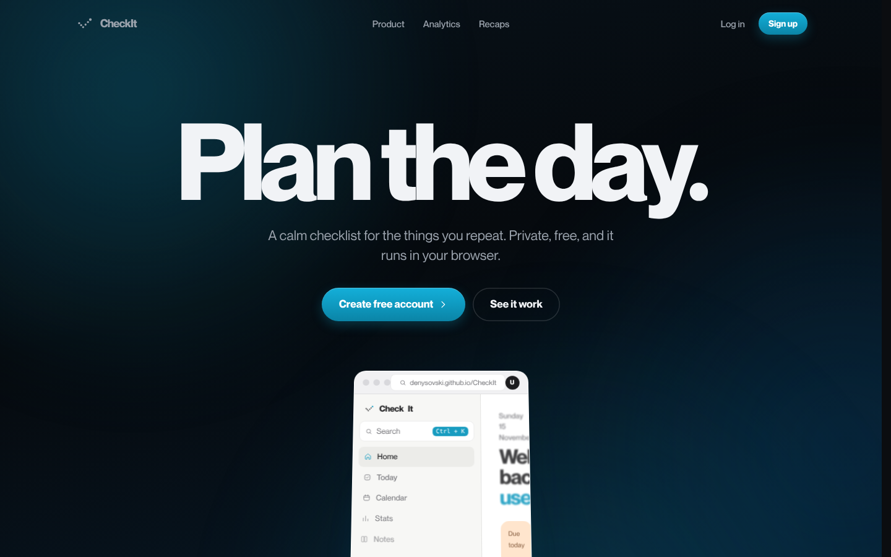

> A personal school / portfolio project. Free to use while in testing. No company, no server, no tracking.

## What it does

- **Today:** your daily tasks, one tap to tick them off.
- **Planner:** drag tasks into the days of your week.
- **Calendar:** every day fills a ring.
- **Journal:** pick a mood and write a few lines.
- **Notes:** quick notes with simple formatting.
- **Stats and recaps:** streaks, best days, what slipped, and a weekly recap every Monday.

## Screens

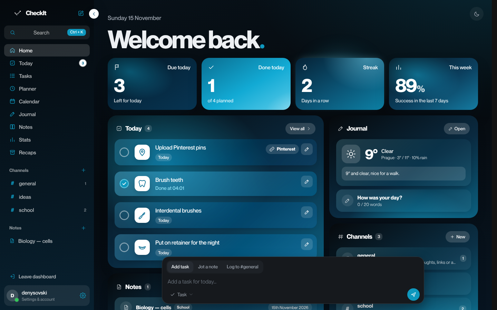

| Today | Planner |
| --- | --- |
| 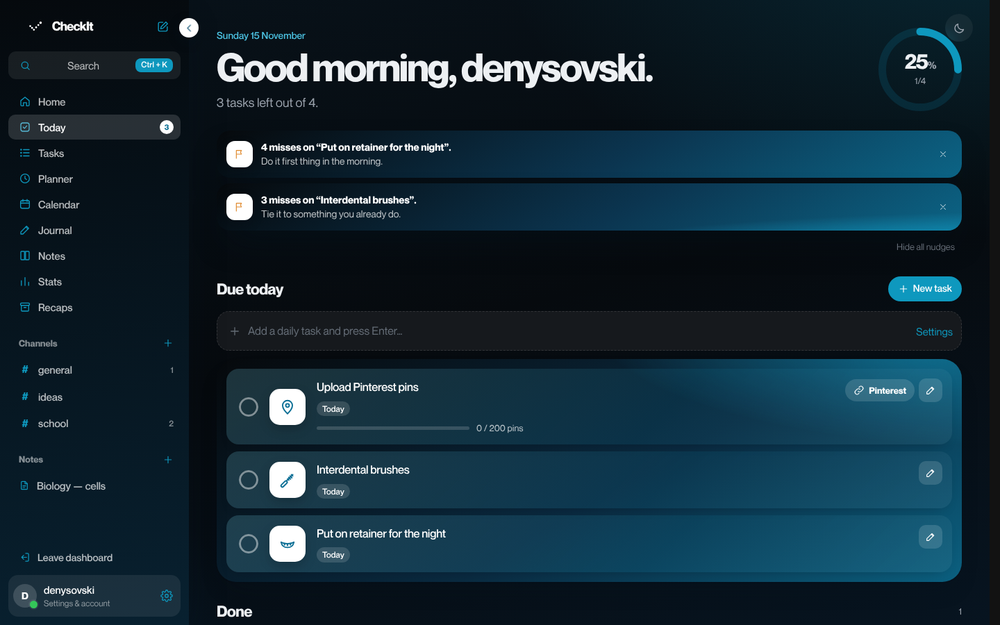 | 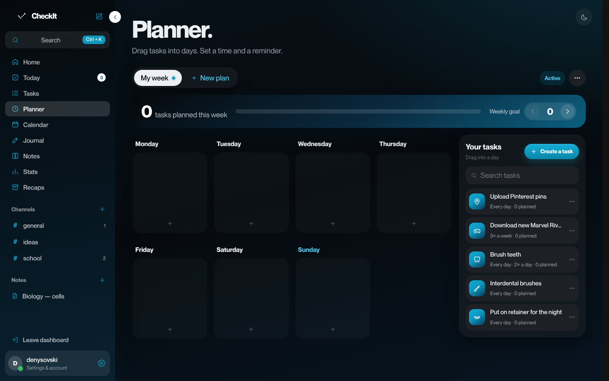 |
| **Calendar** | **Journal** |
| 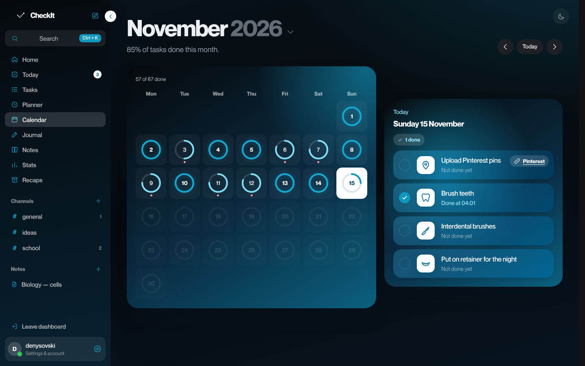 | 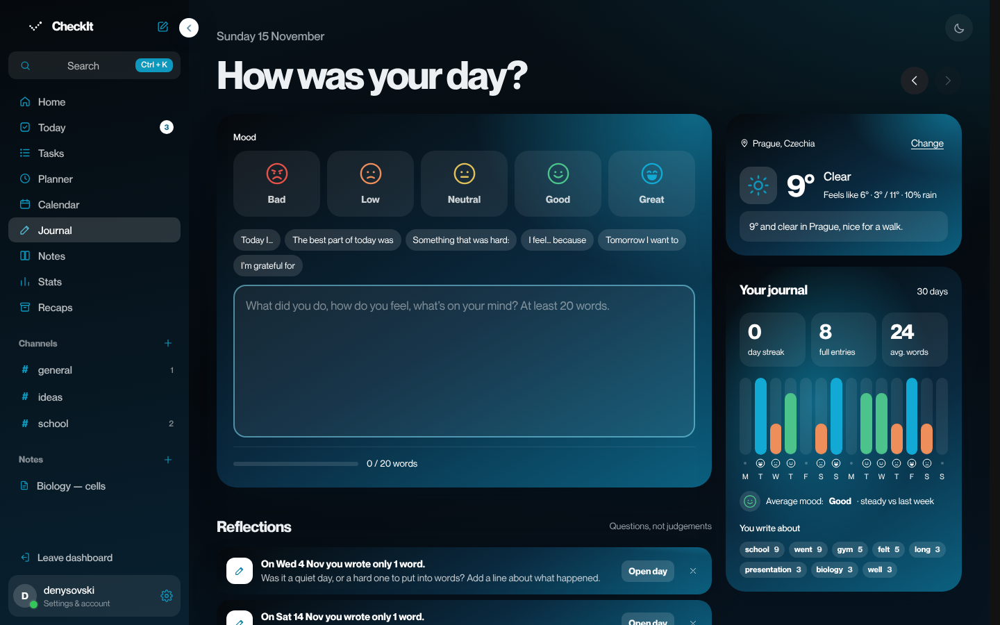 |
| **Notes** | **Stats** |
| 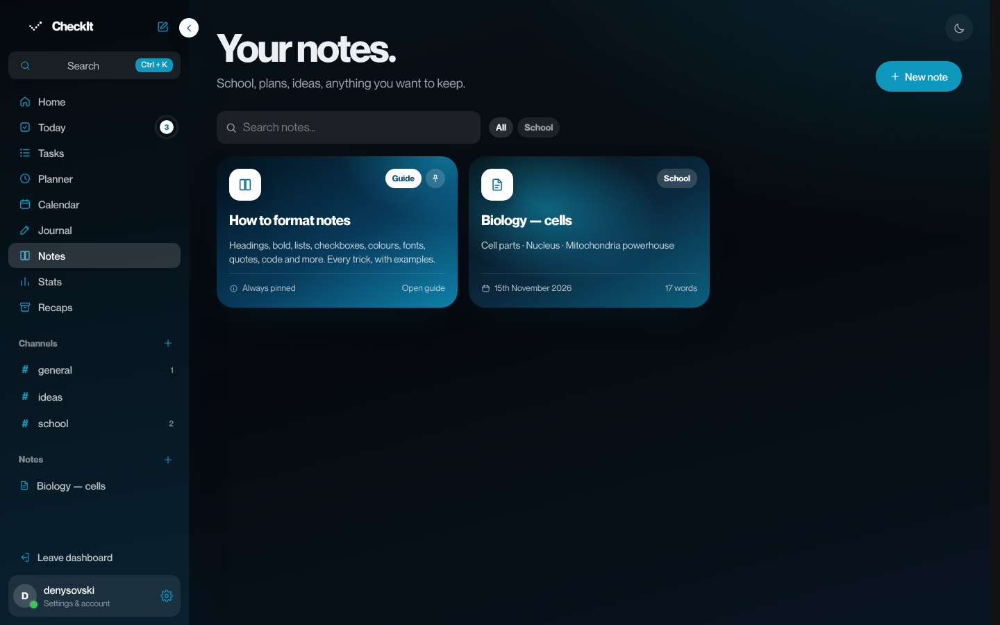 | 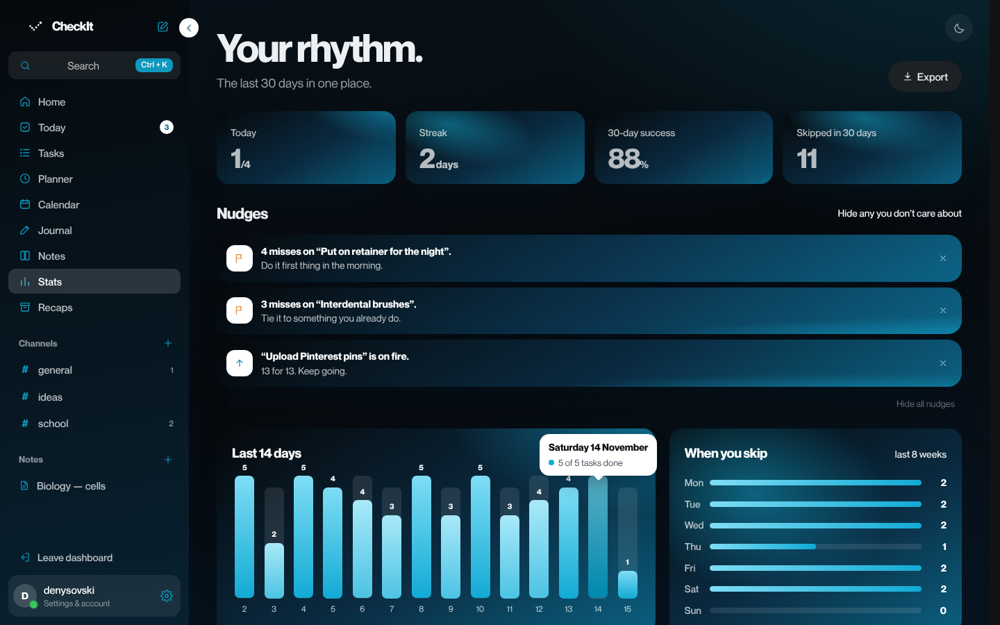 |
| **Sign up** | **A look inside** |
| 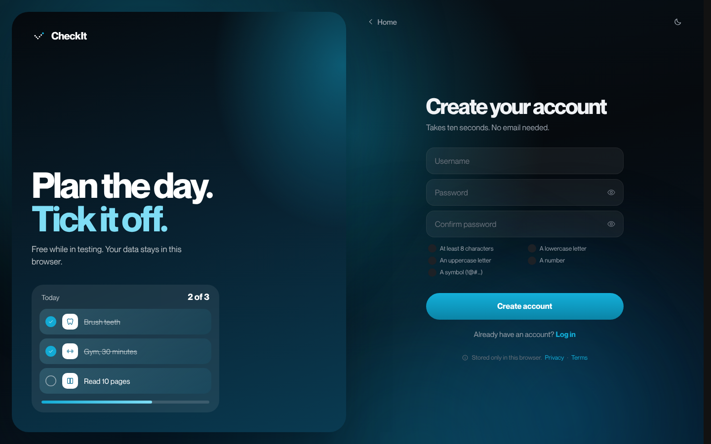 | 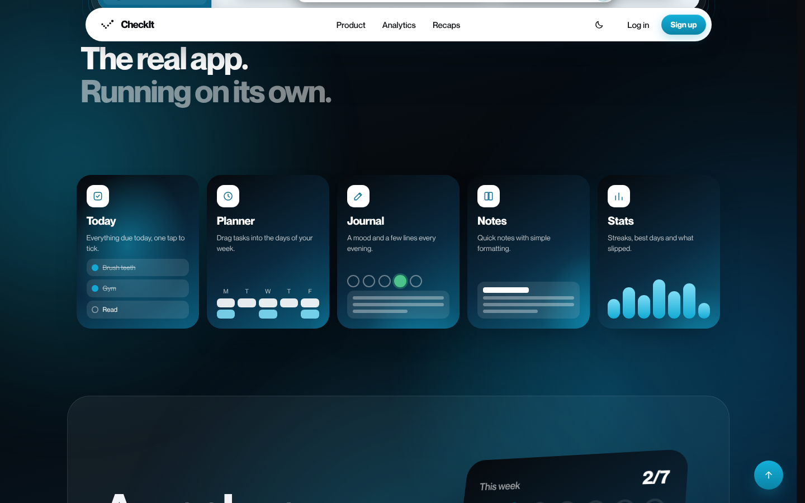 |

### On your phone

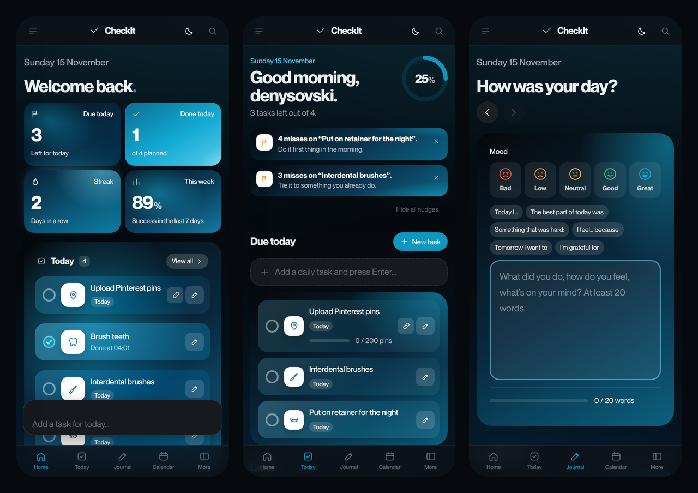

## Privacy

- Everything is saved in your browser (`localStorage` and IndexedDB). Nothing is sent to a server.
- Passwords are salted and hashed on your device.
- Location and notifications are optional and only asked for when needed.
- Outside services are used only for weather and city search ([Open-Meteo](https://open-meteo.com)), an approximate location fallback ([BigDataCloud](https://www.bigdatacloud.com)), task icons ([Iconify](https://iconify.design)) and brand logos ([SVGL](https://svgl.app)).

## Tech

- Plain HTML, CSS and JavaScript modules, no build step.
- Hosted on GitHub Pages, deployed on every push to `main`.
- Works offline and can be installed as an app.
- [Motion](https://motion.dev) and [Lenis](https://lenis.darkroom.engineering) for animation and smooth scrolling.

## License

[MIT](LICENSE)
