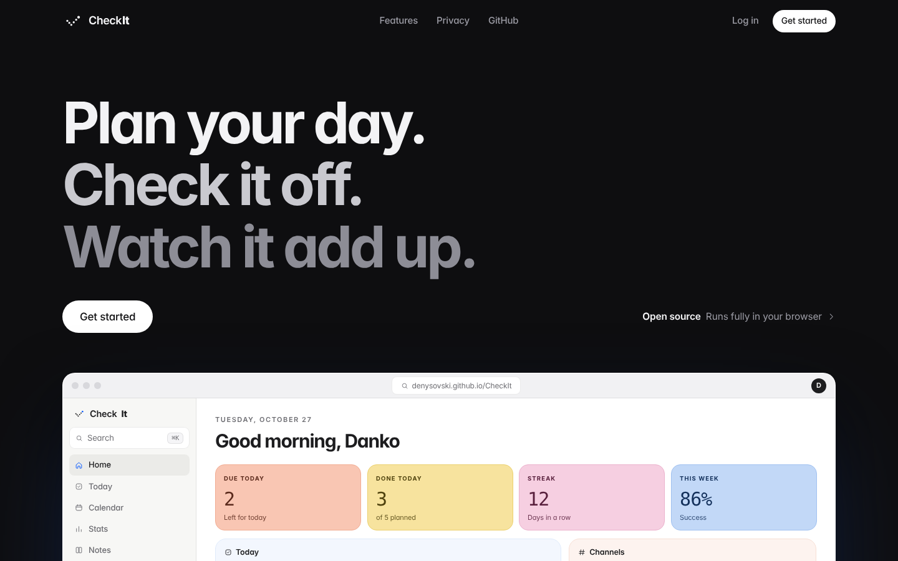
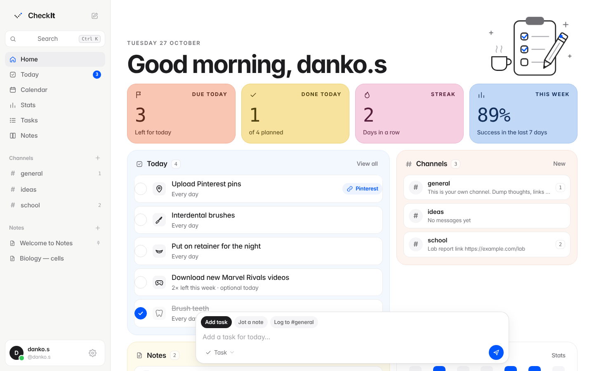
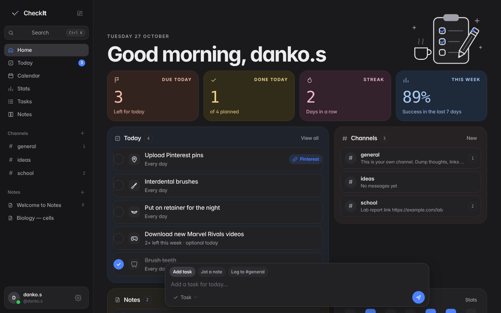
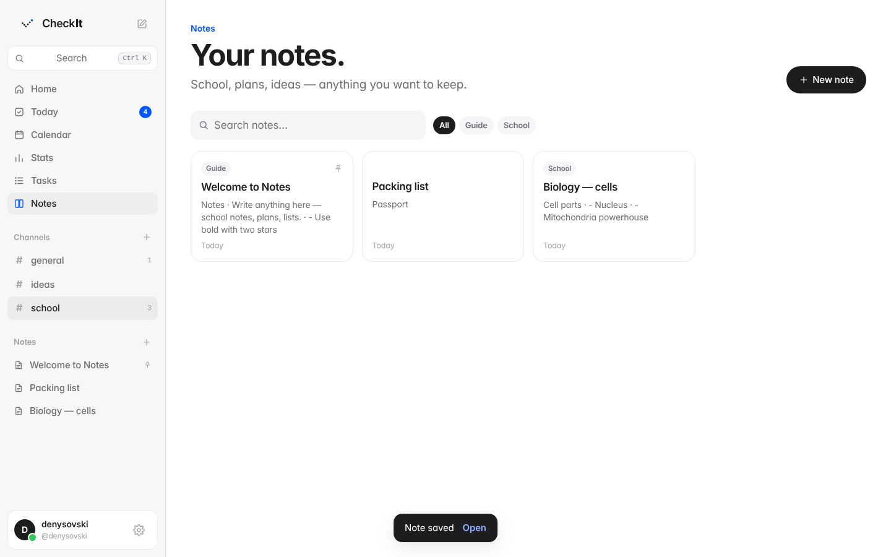

  

<h1 align="center">Check It</h1>

A calm daily checklist for the small things you keep forgetting.

<a href="https://denysovski.github.io/CheckIt/"><b>Open the app →</b></a>

## Why

I built Check It for my own routine — brushing teeth, interdental brushes, the retainer at night, daily Pinterest uploads, new Marvel Rivals clips. It's open source, so feel free to use it for yours.

## What it does

- **Checklist** — what's due today, what's left this week, what's done.
- **Your rhythm** — every day, 3× a week, or only on Mondays.
- **Channels & notes** — a place to log thoughts and keep school notes.
- **Search** — find anything with ⌘K / Ctrl K.
- **Calendar & stats** — see when you showed up and what you skip.
- **Export** — your activity, stats and notes as CSV, Markdown or JSON.
- **Reminders** — a notification when you open the browser.
- **Light & dark** — follows your system, or pick one.

## Private by design

Everything runs locally in your browser (localStorage + IndexedDB). There's no server and no tracking — nothing is sent to me or anyone else, and no one can see your data. Passwords are hashed on your device. Your data is only gone if you clear this site's data in your browser.

## Palette

White canvas, black components, one quiet blue. Red only shows up where something was missed. Inspired by Apple's [Human Interface Guidelines](https://developer.apple.com/design/human-interface-guidelines/). Type: [Satoshi](https://www.fontshare.com/fonts/satoshi) and [Geist Mono](https://vercel.com/font). Logos by [SVGL](https://svgl.app), motion by [GSAP](https://gsap.com) and [Lenis](https://lenis.darkroom.engineering).

## Screens

## License

[MIT](LICENSE) — use it, fork it, make it yours.
