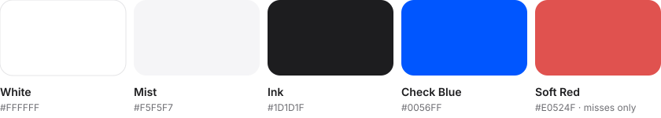
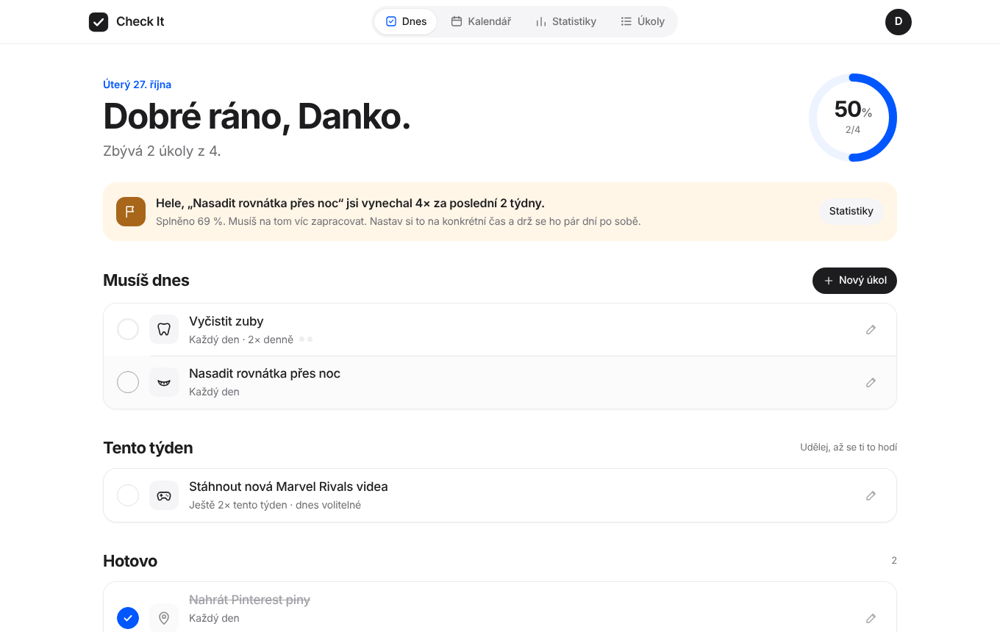
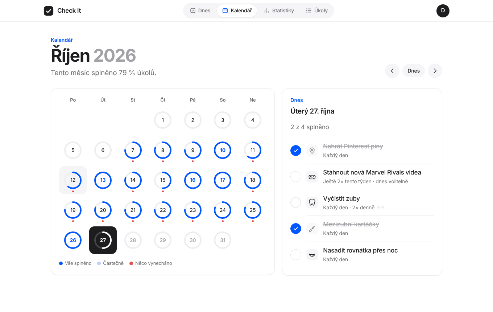

<p align="center">
  
</p>

<h1 align="center">Check It</h1>

<p align="center">A calm daily checklist that doesn't let you forget.</p>

<p align="center"><a href="https://denysovski.github.io/CheckIt/"><b>Open the app →</b></a></p>

---

## Idea

Small things are the easiest to skip — brushing your teeth twice, interdental brushes, putting your retainer on before bed, uploading today's Pinterest pins, grabbing the new Marvel Rivals clips. Check It keeps them in one quiet list, tells you what *must* happen today, and is honest with you about what you keep skipping.

## What it does

- **Daily checklist** — tasks are sorted into *Must do today*, *This week* and *Done*.
- **Weekly frequency** — every task has its own rhythm: 1–7× a week or specific weekdays, plus several times a day (e.g. teeth 2×).
- **Goals that end** — "upload pins until 200 are up": progress bar, then the task retires itself.
- **Custom calendar** — every day is a ring; close it. Tick off a forgotten task retroactively.
- **Stats & nudges** — completion rate, streaks, weekday patterns and a plain message when you skip something too often.
- **Browser reminders** — a system notification with your unfinished tasks every time the app opens (set it as your browser's startup page or install it as an app), plus an evening reminder.
- **Local accounts** — sign up / log in; everything is stored in this browser only (localStorage + IndexedDB, persistent storage requested). Passwords are hashed with PBKDF2.
- **Onboarding motion** — a short animated tour after registration.
- **Icons** — custom line glyphs plus brand logos from [SVGL](https://svgl.app).

## Palette



White canvas, black components, one quiet blue. Red appears only where something was missed. Typography and spacing follow Apple's [Human Interface Guidelines](https://developer.apple.com/design/human-interface-guidelines/).

## Screens




## Run locally

No build step — plain HTML, CSS and ES modules.

```bash
python3 -m http.server 8000
# open http://localhost:8000
```

Deployed to GitHub Pages on every push to `main`.
