

  

<h1 align="center">Check It</h1>

A calm daily checklist, journal and notebook for the small things you keep forgetting.

<a href="https://denysovski.github.io/CheckIt/"><b>Open the demo →</b></a>

> **This is a student portfolio project, not a real product.**
> I built Check It for my own routine and as a school / portfolio piece. It's an open-source demo: there is no company, no server and no support behind it. Feel free to try it or fork it.

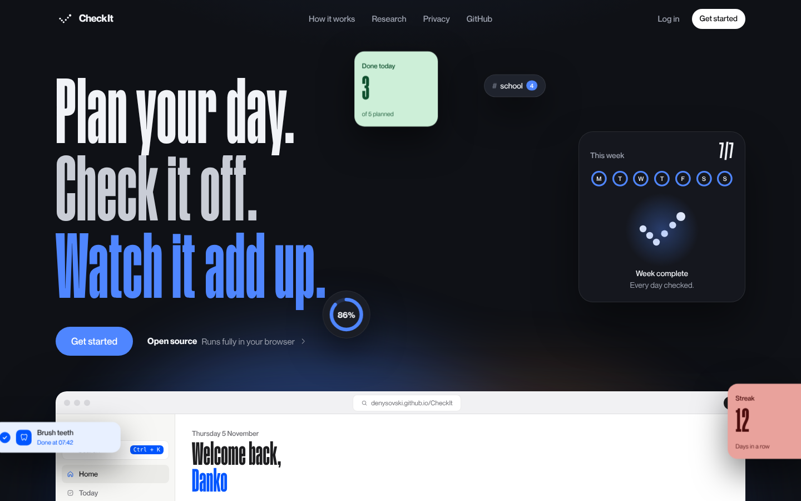

---

## Contents

- [The idea](#the-idea)
- [Privacy and what the app asks for](#privacy-and-what-the-app-asks-for)
- [Screens](#screens)
  - [Landing page](#landing-page) · [Sign up and onboarding](#sign-up-and-onboarding) · [Home](#home) · [Today](#today) · [Calendar](#calendar) · [Stats and nudges](#stats-and-nudges) · [Journal](#journal) · [Tasks and the task editor](#tasks-and-the-task-editor) · [Notes](#notes) · [Channels](#channels) · [Search](#search) · [Settings](#settings) · [Export and import](#export-and-import) · [Dark mode and the sidebar](#dark-mode-and-the-sidebar)
- [How the analysis works](#how-the-analysis-works)
- [Tech](#tech)
- [License](#license)

## The idea

Small daily things are the easiest to skip , brushing teeth twice, interdental brushes, putting the retainer on at night, uploading Pinterest pins, downloading new Marvel Rivals clips. Check It keeps them in one place, tells you what's due today, shows what you skipped, and gives you a short journal to write down how the day went.

## Privacy and what the app asks for

- **Everything stays in your browser.** Accounts, tasks, history, notes, channels and journal entries are saved with `localStorage` and IndexedDB on your device. Nothing is sent to me or to any server, and nobody else can see your data.
- **Passwords** are salted and hashed on your device (PBKDF2). They're never stored in plain text.
- **Location (optional).** During sign up, and later in Settings, the app asks where you live. It's only used to show the weather on the Journal page. You can search for a city or press *Use my location*: the browser asks for permission first, and if you refuse, the app makes an approximate guess from your IP address and says so. You can skip this or remove the location at any time.
- **Notifications (optional).** The browser asks for permission before the app shows any reminders.
- **Outside services** are only called for the parts that need them: weather ([Open-Meteo](https://open-meteo.com)), city search ([Open-Meteo Geocoding](https://open-meteo.com/en/docs/geocoding-api)), IP-based location fallback ([BigDataCloud](https://www.bigdatacloud.com/free-api/free-reverse-geocode-to-city-api)), task icons ([Iconify](https://iconify.design)), brand logos ([SVGL](https://svgl.app)) and the GitHub star count on the landing page.
- Your data is gone only if you clear this site's data in your browser, or delete it in Settings.

## Screens

### Landing page

A short, minimal page on a slowly moving blue-black background (light blue in light mode). The navigation turns into a white floating bar once you scroll. Under the headline a live copy of the dashboard plays on its own: a cursor ticks off tasks, types a new one, writes in a channel and opens the calendar. The demo tilts upright in 3D as it scrolls into view, and a large week card, leaning in perspective and following the pointer, fills its rings one day at a time.

Further down, **Why writing it down works** lists three research results with links to the sources, and a privacy section states the plain facts (no servers, no trackers). There are no made-up user numbers. The footer has a newsletter field (there is no server yet, so it says so and points to GitHub releases), links to the **Terms**, **Privacy Policy** and **Cookies** pages (`#/terms`, `#/privacy`, `#/cookies`), the repository and social profiles.

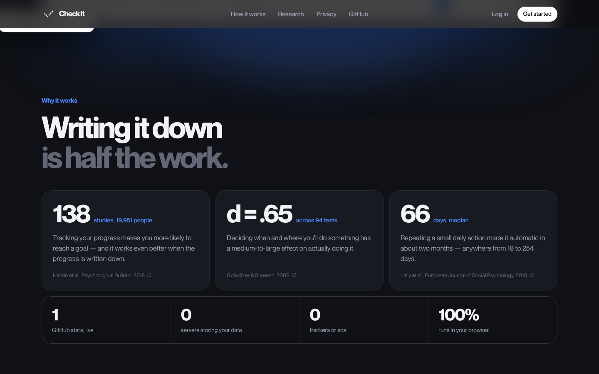

### Sign up and onboarding

Sign up needs only a username and a password typed twice. The password must have at least 8 characters, an uppercase and a lowercase letter, a number and a symbol, and the checklist updates as you type. Log in has a *Remember me* option. After signing up a six-step onboarding (about 16 seconds) shows ticking tasks, the planner, stats and reminders. Each step's picture and text arrive together; *Continue*, the arrow keys or *Skip* move you on. Then the app asks about notifications and your location (both optional) and offers a list of suggested tasks.

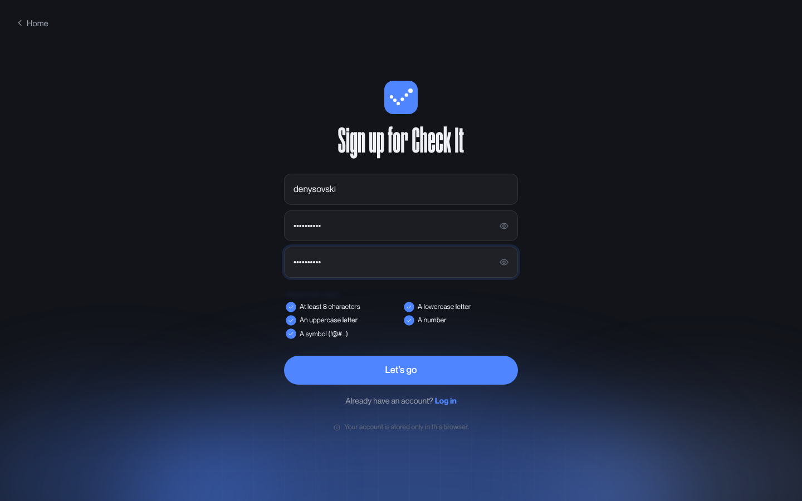

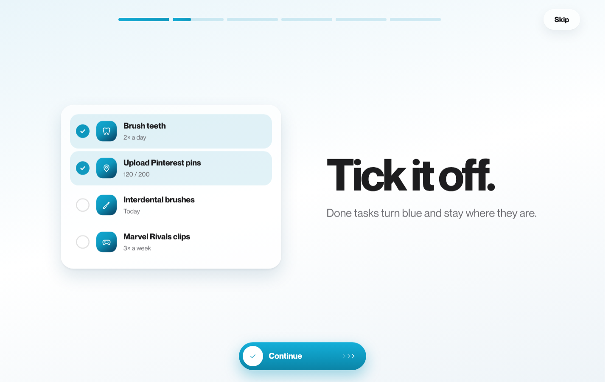

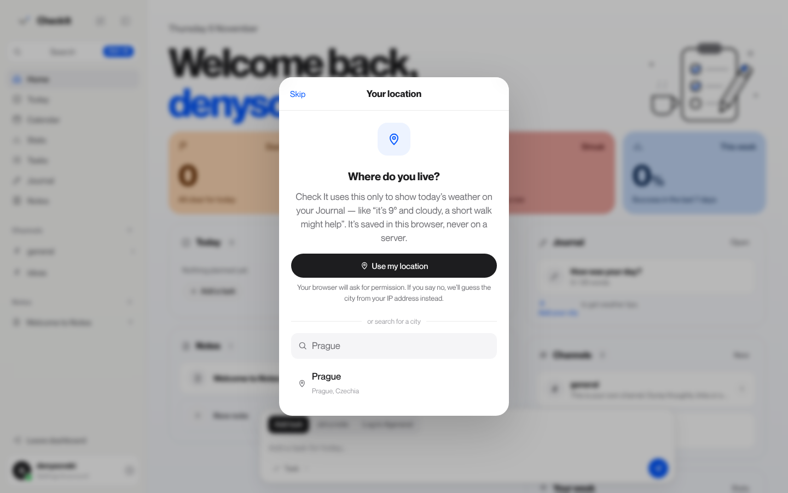

There are **33 suggestions** in categories: Creator, Body care, Health, Home, Mind, Social, Study & work. Examples are skincare, creatine, vitamins, cleaning your room, tidying drawers, folding clothes, laundry, a weekly cheat day, texting friends and going for a walk. You can search them, pick single ones or *Select all* in a category.

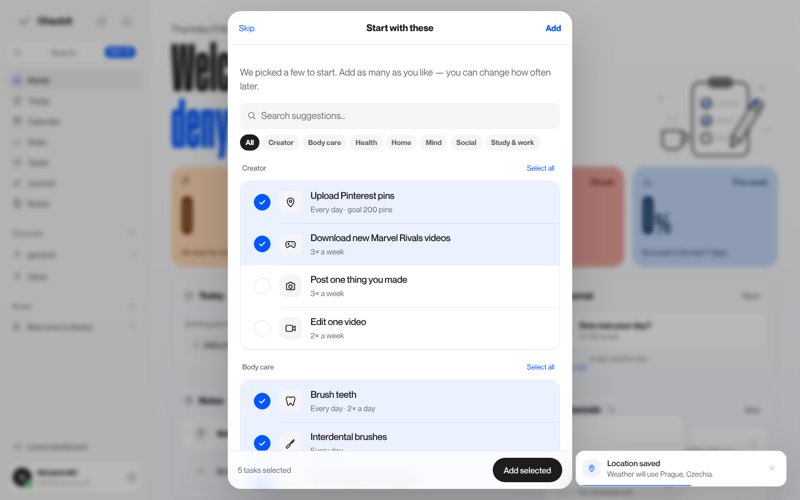

### Home

- **Overview:** a greeting and four tiles in four shades of blue: *Due today* (darkest), *Done today* (lightest), *Streak* (with a flickering flame and a pulse) and *This week*.
- **Cards:** every section sits on its own slowly drifting blue gradient, so no two look the same. Task cards have an edit (pencil) button that opens the task in Tasks.
- **Today:** what's planned for today.
- **Journal:** today's word count, your mood and a weather tip.
- **Channels and Notes:** recent messages and notes.
- **Your week:** a black-to-blue card with this week's numbers (done, earliest finish, usual finish time, best day) and a bar per day. A soft light follows the pointer.
- **Composer:** the box at the bottom adds a task, a note or a channel message with one Enter.

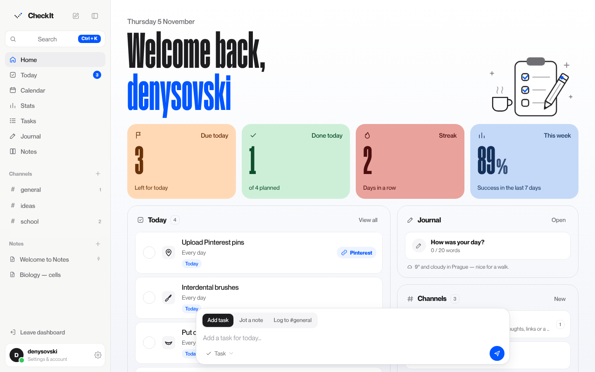

### Today

Tasks are split into **Due today**, **This week** (flexible tasks you can do on any day) and **Done**. Each task has labels such as *Today*, *Due today*, *This week*, *2 of 3 this week* or *2× left today*. When you tick a task, the row turns blue and its text changes to *Done at 18:31*, then it moves to Done. A small window congratulates you, with a different message for the first task of the day, the ones in between and the last one.

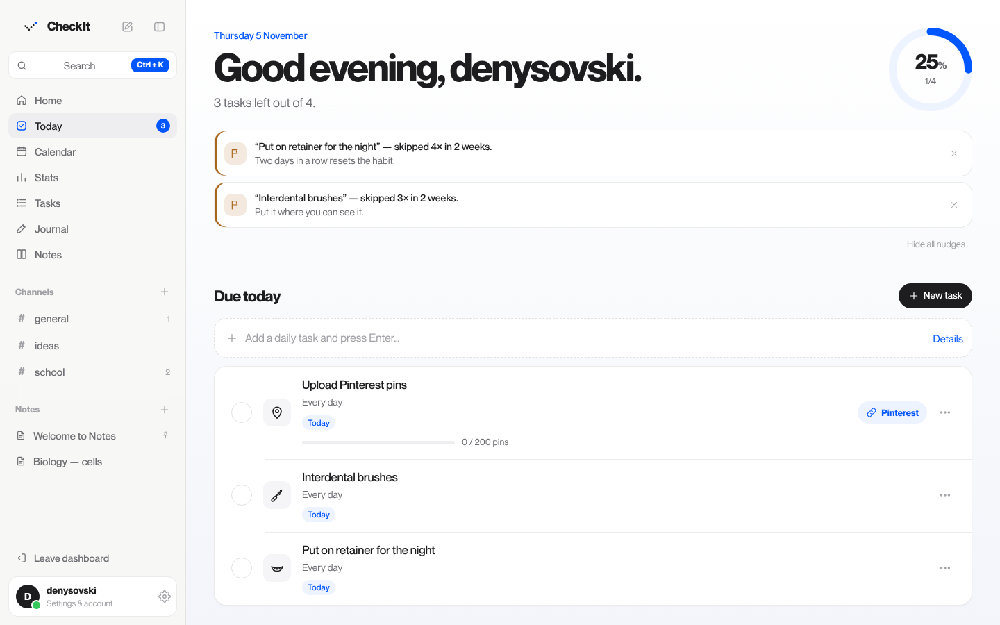

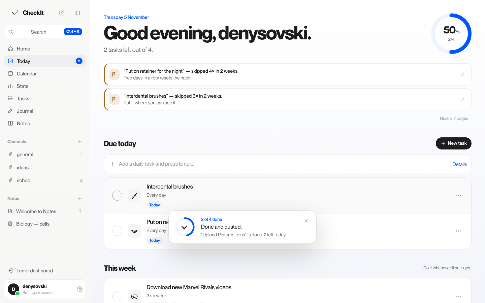

### Planner

Plans are sets of days. Drag a task from **Your tasks** on the right into a day (on phones, press and hold, then drag), or tap a task and pick days, including *Weekdays*, *Weekend* or *Every day*. Tap a planned task to set its time, repeat (*Every week*, *Every other week*, *This week only*) and whether you want a reminder. You can keep several plans (for example a school week and a holiday week), switch which one is active, and set a weekly goal for how many tasks you plan.

The active plan makes those tasks due on those days. Today sorts them by time and shows the time on the card, and a reminder fires at the planned time while Check It is open.

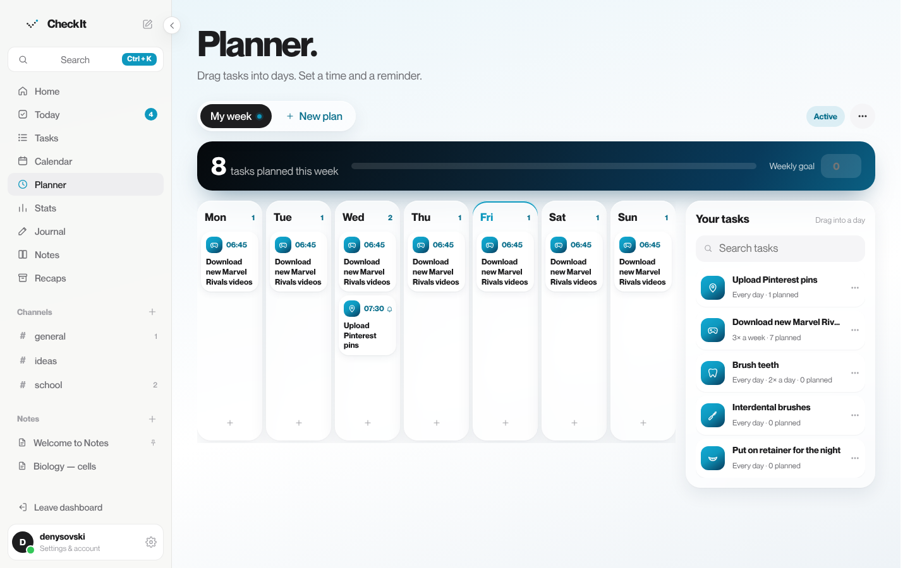

### Calendar

Every day is a ring: a full ring means everything was done, a partial ring means some of it, and a red dot means something was skipped. The ⓘ bubble explains this. Click a day to see what you did and at what time, or tick off something you forgot. Moving between months slides the calendar, and the month name rolls like a slot machine.

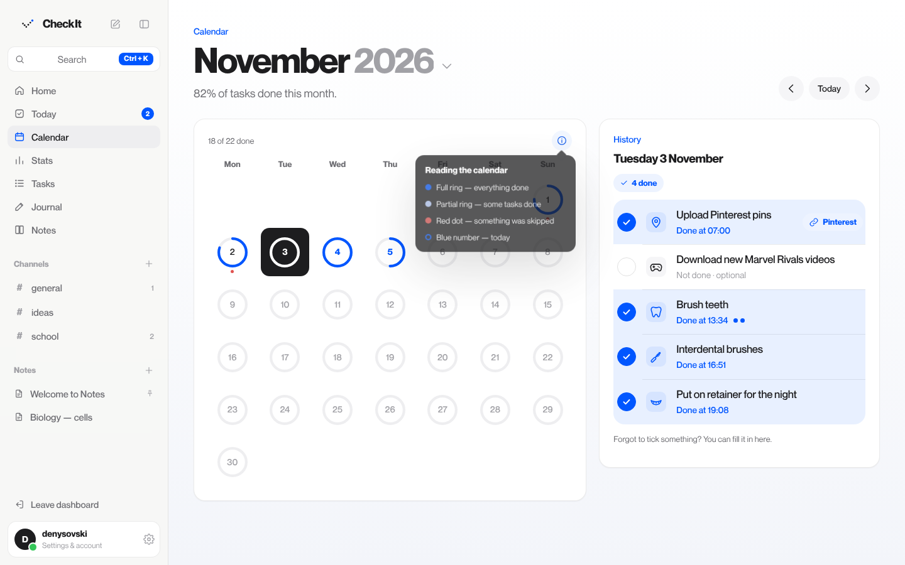

### Stats and nudges

**Stats** shows:
- today's progress, your streak, your 30-day success rate and how many tasks you skipped;
- a 14-day chart;
- which weekdays you skip most;
- each task ranked by how often it's skipped.

**Nudges** are short cards like *“Put on retainer for the night” , skipped 4× in 2 weeks*. Each card has an ✕ that hides it for a week, and *Hide all nudges* turns them off. You can turn them back on in Settings.

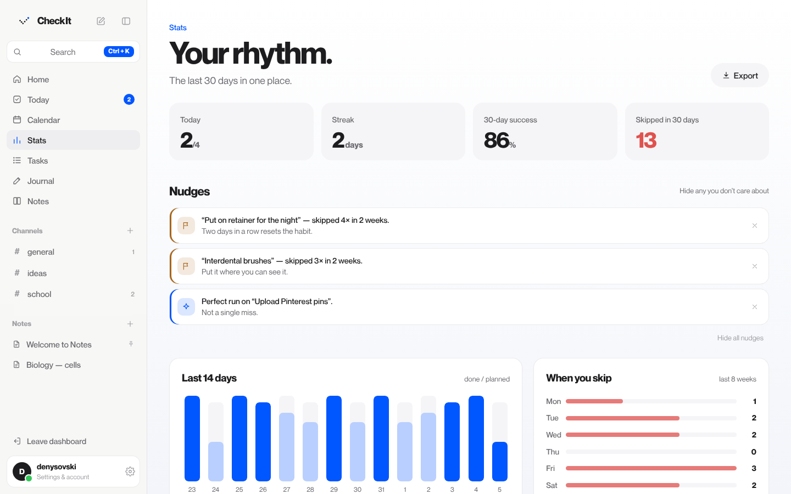

### Journal

- **Daily entry:** one entry per day, at least 20 words. Pick a mood (Rough, Low, Okay, Good, Great), tap a prompt like *The best part of today was…* or just write.
- **Word bar:** fills up until you reach 20 words.
- **Weather tip:** the side card shows the weather where you live with a suggestion. For example, on a low day: *“Feeling low? It's 9° and cloudy in Prague , a 15-minute walk outside might help.”*
- **Your journal card:** your journaling streak, how many entries are complete, your average length, your mood over the last 14 days and the words you use most.
- **Reflections:** questions about your entries (see [How the analysis works](#how-the-analysis-works)).
- **Past entries:** open any older day and keep writing.

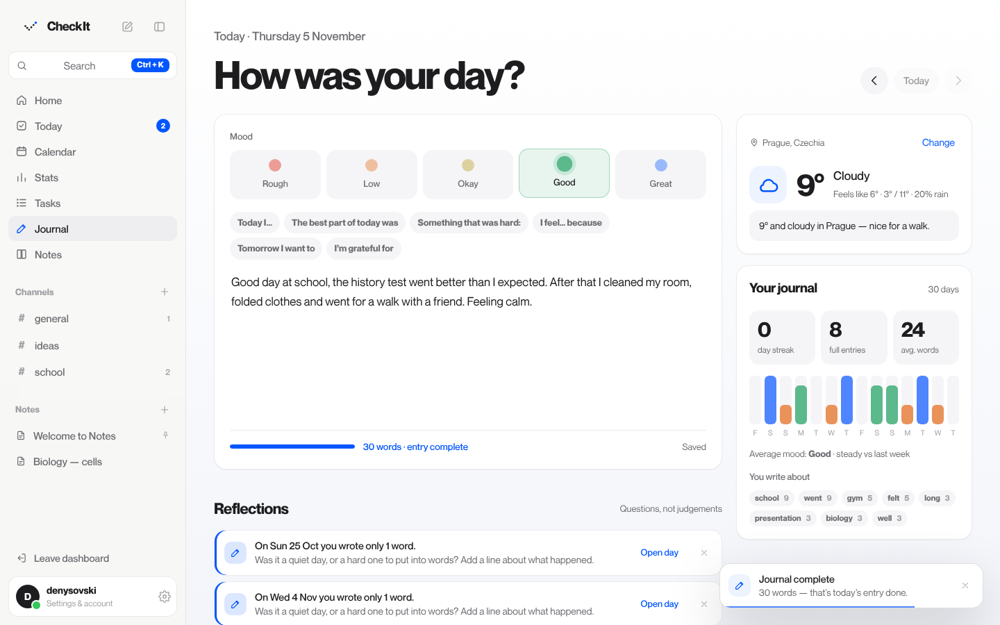

### Tasks and the task editor

The task list lets you reorder, edit, archive and delete tasks, and add new ones quickly. In the editor you set:
- the name;
- a link, which shows as a button on the task (for example your Pinterest or Meta Business page);
- an icon: built-in symbols, **200,000+ open-source icons from Iconify**, or brand logos from SVGL;
- how often: 1–7× a week or specific days, and how many times a day;
- an optional goal that finishes the task, such as *upload pins until there are 200*.

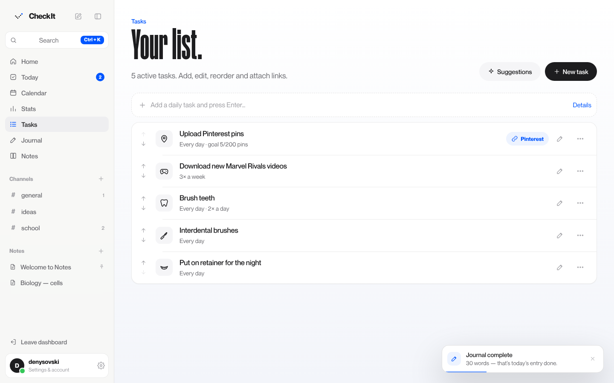

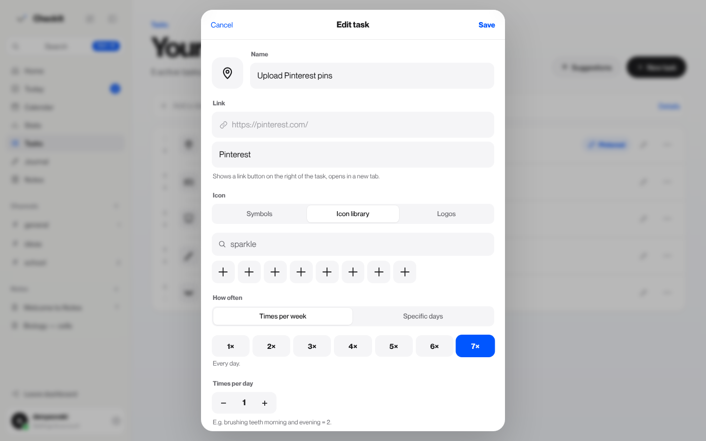

### Notes

Notes for school and anything else. Each note can have a tag and be pinned, and it saves as you type. Notes support light formatting: `# headings`, `- lists`, `[ ] checkboxes` and `**bold**`. There's a preview mode where you can tick the checkboxes, and you can download any note as Markdown.

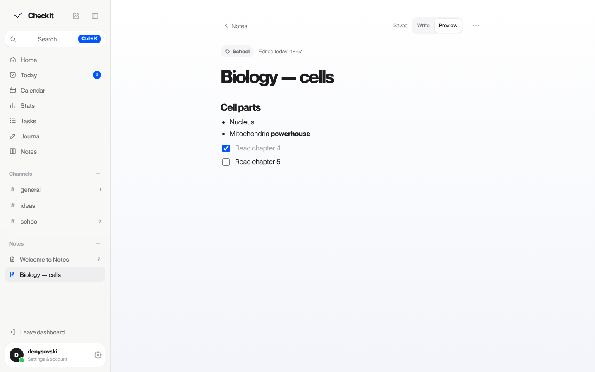

### Channels

Channels are your own text streams, like a chat with yourself for one topic: `#school`, `#ideas`, a gym log. Messages are grouped by day, links can be clicked, and you can copy or delete messages.

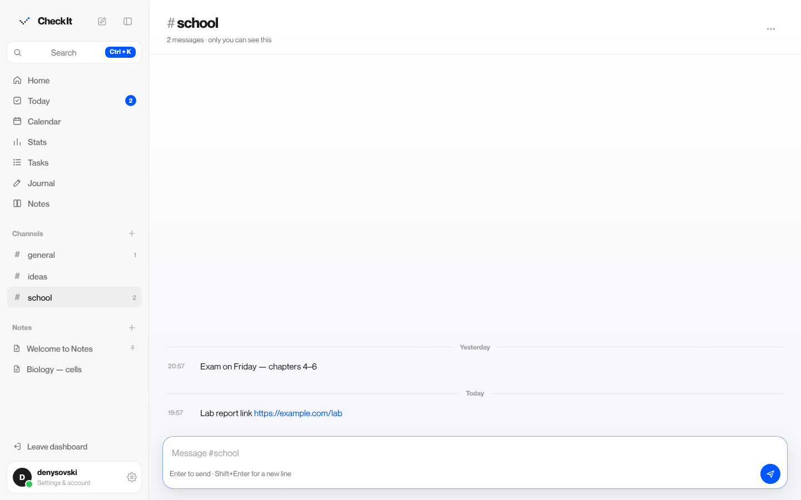

### Search

Press **Ctrl + K** (⌘K on Mac) to search tasks, notes, journal entries, channels and messages, or to run an action such as *New task* or *Switch to dark mode*. Only the results list scrolls while search is open.

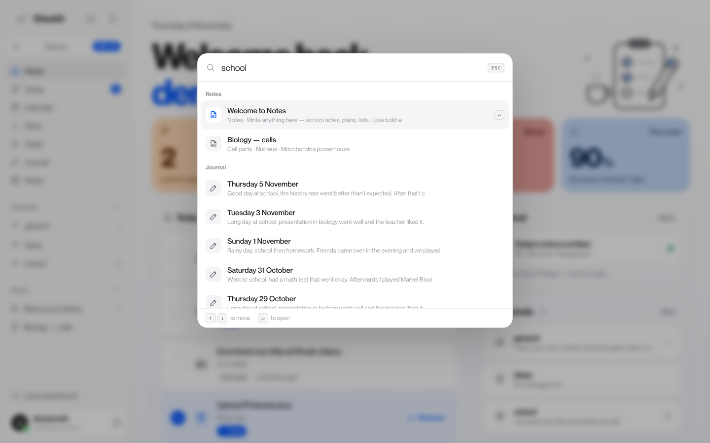

### Settings

Settings has five groups:
- **You:** your name and location.
- **Reminders:** browser notifications, an evening reminder (it also tells you if today's journal is still empty) and the nudges switch.
- **Appearance:** light, dark or system theme, and animations on or off.
- **Your data:** export and import.
- **Account:** log out, delete the account or clear everything.

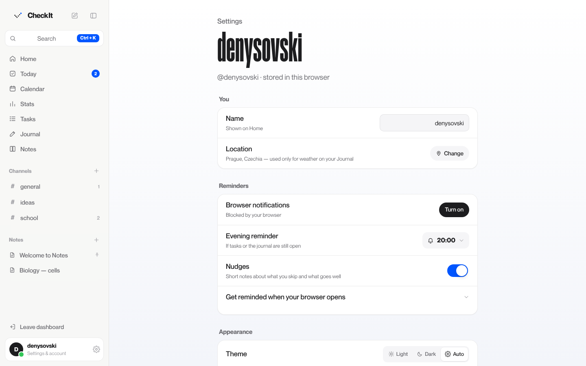

### Export and import

Export is in Stats, Settings and the account menu:

| Export | Format | What's inside |
| --- | --- | --- |
| Activity log | CSV | Every task on every day: done, skipped or optional, the time it was done, the frequency |
| Stats summary | CSV | 7- and 30-day success per task, goals, streak |
| Notes | Markdown | All notes |
| Journal | Markdown | Every entry with its mood |
| Channels | CSV | All messages with date and time |
| **Everything** | `.checkit.json` | One file with all tasks, history, notes, channels, journal and settings |

**Import** reads a `.checkit.json` file, so you can move your data to another account, browser or computer. The app first shows what the file contains, then you choose:
- **Merge:** keep what's here and add what's new.
- **Replace:** swap this account's data for the file's.

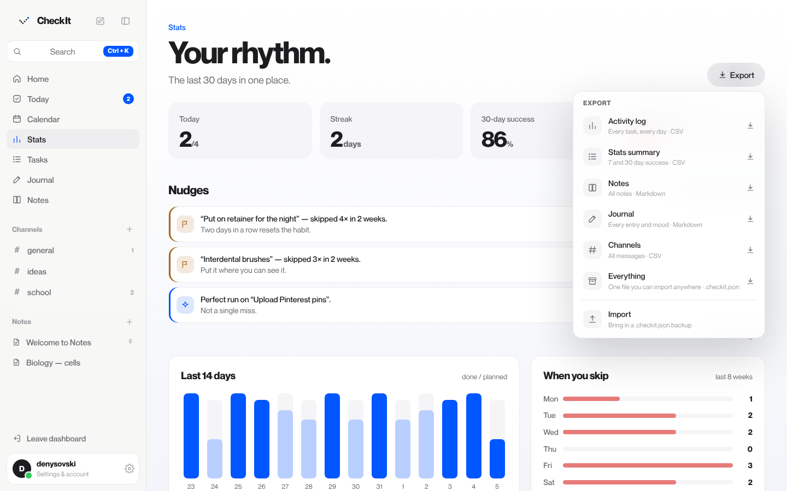

### Dark mode and the sidebar

Dark mode uses a charcoal background with a soft blue tint, not pure black, and has no white surfaces. You can collapse the sidebar to icons only (channels become `#G`, `#I`, …). *Leave dashboard* takes you back to the landing page without logging you out.

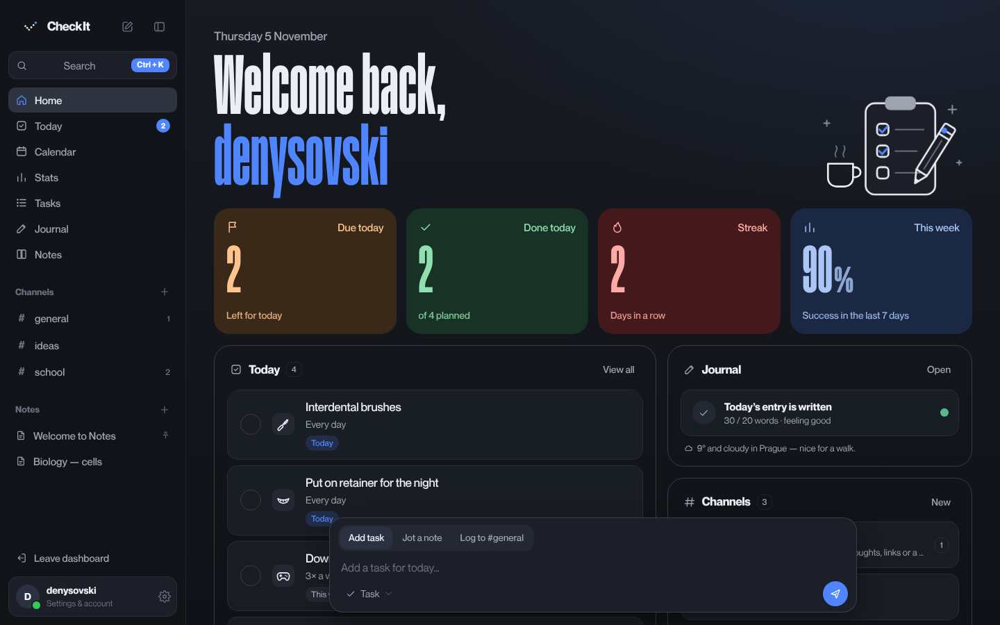

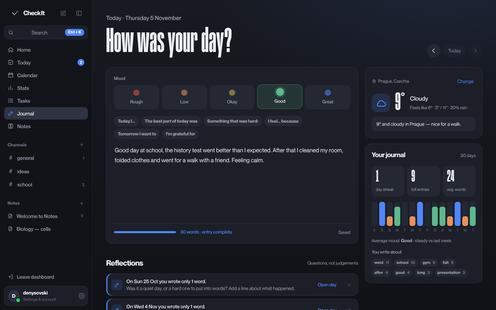

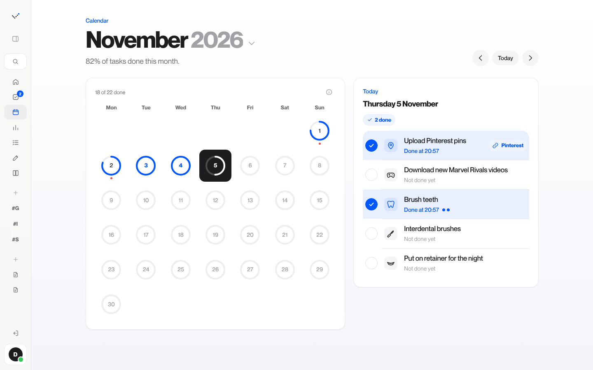

## How the analysis works

All of it runs in the browser on your own data.

- **Tasks:** for each task, the app counts the days it was done and the days it was skipped over 7, 14 and 30 days. A task you do *3× a week* only counts as skipped when the week ends without three completions. Nudges point out the tasks you skip most, your weakest weekday, tasks with a perfect run and streaks of 3+ days. The wording changes from day to day so it doesn't repeat.
- **Journal:** the app looks at the last 30 days and finds:
  - short entries, which turn into a question like *“On Tue 3 Nov you wrote only 6 words , was it a quiet day, or a hard one to put into words?”*;
  - missed days (3+ in a week);
  - three low moods in a row;
  - whether your mood went up compared with last week;
  - how your task completion differs between good and low days.

  Reflections are questions, not judgements, and you can hide them like nudges.
- **Weather:** Open-Meteo provides the current temperature, conditions and today's chance of rain for your saved location. The suggestion depends on the weather and the mood you picked: a walk when it's mild, a jacket when it's wet, staying in during a storm.

## Tech

- Plain HTML, CSS and JavaScript modules with no build step. It's hosted on GitHub Pages and deployed by a GitHub Actions workflow on every push to `main`.
- Works offline once loaded (service worker) and can be installed as an app.
- Responsive from phones to wide desktop screens. On phones a bottom tab bar replaces the sidebar.
- Motion uses CSS and [Motion](https://motion.dev) (bundled in `vendor/`, MIT) for the onboarding. Animations can be turned off in Settings and follow the system *reduce motion* setting.

## License

[MIT](LICENSE) for the code. This is a personal school/portfolio demo, not a commercial product.
